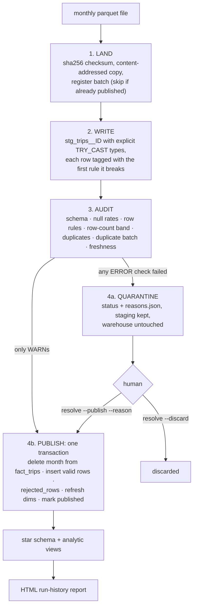

# data-publishing-pipeline

**A data pipeline that refuses to publish bad data.** Each new monthly file is staged, checked against a
written data contract, and then either published in one atomic step or quarantined with the exact failing
checks. Re-running any month is safe.

[](https://github.com/imrithwik1908/data-publishing-pipeline/actions/workflows/ci.yml)

**Who it is for:** an analytics or data engineer who owns a recurring file feed (here, NYC TLC yellow taxi
trips, about 3.6M rows a month) whose analysts depend on the tables built from it.

**The problem:** monthly files change shape or contain garbage: new columns, changed types, impossible
values, missing rows, duplicates. If a pipeline writes straight into production tables, analysts silently
get wrong numbers, and somebody notices weeks later.

<!-- TODO: record a 20-second GIF of `make demo` (e.g. with vhs or asciinema) and put it here -->

## Results (all measured by `make reproduce`, see [results/RESULTS.md](results/RESULTS.md))

| Claim | Measured |
|---|---|
| Injected defect types handled as specified, on real data | **8 / 8** |
| Re-running a month 5 times gave identical table fingerprints | **5 / 5** |
| Partial publishes after a crash forced mid-publish | **0** |
| Quarantined batches that changed the warehouse | **0** |
| 4 real months backfilled in reverse order = same warehouse as in order | **yes** |
| Time to land, audit and publish one real month (~3.6M rows, M-series laptop) | **1.2 to 1.5 s** |

Real-data findings that shaped the contract (also from `make reproduce`):
- **2% to 5% of real fares are negative**, almost all refunds, disputes, and no-charge trips. Only 8 to 28
  per month are card payments. A naive `fare >= 0` rule would quarantine every real month.
- **Null `passenger_count` rose from 10% to 23%** between Nov 2024 and Feb 2025. All of it is
  flex-fare trips. A fixed null-rate limit would have started failing good data, so contract v2 uses a
  rule that encodes the meaning (see [DECISIONS.md](DECISIONS.md) D1 and D11).
- **Real schema change:** `cbd_congestion_fee` appears in January 2025. Both sides of the change publish
  with no manual work.

## Quickstart (under 5 minutes)

Needs [uv](https://docs.astral.sh/uv/) and about 250 MB of disk.

```bash
git clone https://github.com/imrithwik1908/data-publishing-pipeline.git && cd data-publishing-pipeline
make demo        # downloads 3 real months (~180 MB once), publishes them, injects 8 defects
open data/demo/report/index.html
```

Other entry points:

```bash
make test                      # 34 tests on synthetic data, no downloads, ~6 s
make reproduce                 # re-measure every number in this README
uv run pipeline run 2025-03    # fetch + process one month into data/warehouse.duckdb
uv run pipeline backfill --from 2024-07 --to 2025-06
uv run pipeline status         # batch history
uv run pipeline explain 6      # every check result for a batch
uv run pipeline resolve 6 --discard            # or --publish --reason "..."
uv run pipeline verify         # SQL assertions on the warehouse
uv run pipeline report         # static HTML run history
uv run pipeline compact        # reclaim disk after re-runs (DuckDB files do not shrink on DELETE)
make airflow-install && make airflow-test MONTH=2025-02   # optional: run the Airflow DAG once
```

## How it works



**Warehouse (DuckDB, single file):**
- `fact_trips`, one row per trip, partitioned by `pickup_month`. Dimensions: `dim_zone` (TLC lookup),
  `dim_date`, `dim_payment_type`, `dim_vendor`, `dim_rate_code`.
- Pipeline metadata: `batches` (status lifecycle and contract version), `check_results` (one row per check
  per batch), `rejected_rows` (bad rows with a reason), and a `rejected_batches` view.
- Analytic views in [sql/models/02_views.sql](sql/models/02_views.sql): zone revenue ranked with
  `RANK()`, month-over-month change with `LAG()`, month-to-date running totals, top 10 zones per month,
  and data quality per batch.
- SQL assertions in [sql/assertions/](sql/assertions/). Each query returns violating rows, so an empty
  result means pass.

**The contract** ([contracts/yellow_trips.yaml](contracts/yellow_trips.yaml)) states the columns and
types, null limits, and row rules written as SQL predicates. It also sets the 0.5% rejected-row limit,
the ±40% row-count band against the trailing 3 published months, a duplicate key, and freshness. Each
check is ERROR (quarantines the batch) or WARN (recorded only).

**Orchestration:** [dags/monthly_trips.py](dags/monthly_trips.py) (Airflow 3.4) runs
`fetch → land → write_and_audit → publish → report → outcome`. Each task calls one function in the `dpp`
package, and a quarantine fails the `outcome` task so a human sees it.

## Key decisions

Full reasoning is in [DECISIONS.md](DECISIONS.md). Interview prep is in [DEFENSE.md](DEFENSE.md).

- **Replace the whole month partition, not row upserts.** Trips have no stable key, and the file is the
  unit of delivery.
- **Row-level rejection with a 0.5% cap.** Real files always contain a few hundred bad rows. Many bad rows
  mean something systemic is wrong.
- **Rules that encode meaning beat thresholds.** Negative fares are legitimate refunds, and missing
  passenger counts are flex fares.
- **Row-count baseline by month order, not publish order**, so backfills are order-independent.
- **`publish` refuses any batch that is not `audited`.** Overrides need a written reason, and the reason
  is kept.

## Limitations (honest)

- Single machine and single writer (file lock plus DuckDB's one-writer rule). No distributed coordination.
- Batch, not streaming. One data source. The contract is hand-written.
- The row-count band needs 1+ published months before it can judge; the first month always passes it.
- Money is stored as DOUBLE, as in the source. A finance warehouse should use DECIMAL.
- DuckDB files do not shrink after the delete-and-reinsert cycle. `pipeline compact` rewrites the file (measured 582 → 372 MB on the demo warehouse).
- Airflow is demo-only (`airflow standalone`, SQLite), and CI does not run it.

## Repository map

```
src/dpp/       pipeline package: land, stage, checks, publish, pipeline (steps), cli, report, fetch
contracts/     the data contract (YAML, validated by Pydantic)
sql/           dimension + view models, SQL assertions
dags/          Airflow DAG (thin wrappers)
scripts/       demo.py, reproduce.py
tests/         34 pytest tests on synthetic data
results/       output of `make reproduce`
reference/     TLC taxi zone lookup
```

## What I personally implemented

<!-- TODO (owner): write this yourself, in your own words. Only list what you can explain and defend
line by line in an interview. DEFENSE.md is the study guide for that. -->
